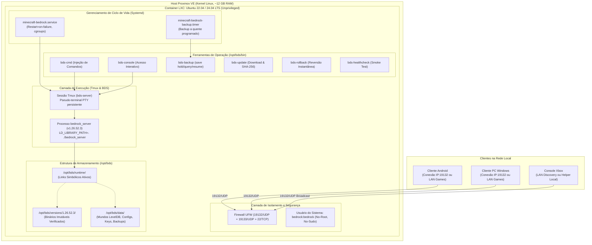

<!--
Responsabilidade: Documento mestre de arquitetura do sistema Bedrock Dedicated Server (BDS).
Apresenta a topologia geral, fluxo de dados, modelo de segurança em camadas e responsabilidades de cada componente.
-->

# Arquitetura do Sistema: Bedrock Dedicated Server (BDS)

## 1. Visão Geral e Objetivos do Sistema

O projeto implementa uma solução de nível de produção para hospedar o **Minecraft Bedrock Dedicated Server (BDS)** em um container LXC sobre Proxmox VE. A arquitetura é orientada aos seguintes pilares de engenharia:

- **Local-First & Autosuficiência**: O servidor opera inteiramente na rede local sem depender de nuvens externas, backends proprietários ou serviços gerenciados de terceiros.
- **Conformidade Estrita com as Fontes Oficiais**: Todas as decisões técnicas e propriedades de configuração baseiam-se na documentação oficial da Mojang/Microsoft inclusa no pacote do BDS v1.26.52.3 e no portal Microsoft Creator.
- **Determinismo e Reprodutibilidade**: Binários com hash SHA-256 verificado, configurações geradas a partir de templates, segredos desacoplados do versionamento e scripts com garantia de idempotência.
- **Separação de Preocupações (Separation of Concerns)**: Desacoplamento rígido entre o código/binário imutável da Mojang, os dados persistentes do mundo e os scripts de gerenciamento do operador.
- **Operação Não Interativa e Segura**: Execução sob usuário sem privilégios de root (`bedrock`), monitoramento contínuo por `systemd`, backup a quente com consistência transacional e capacidade de rollback em segundos.

---

## 2. Diagrama da Arquitetura Geral

---

## 3. Componentes do Sistema e Responsabilidades

### 3.1. Container LXC (Proxmox VE)
- **Sistema Operacional**: Ubuntu 22.04 LTS ou 24.04 LTS (distribuição com suporte oficial declarado pela Mojang no `bedrock_server_how_to.html`).
- **Privilégios**: Container não privilegiado (`unprivileged`), garantindo que qualquer eventual escalonamento de privilégios dentro do container permaneça mapeado como UID não privilegiado no host Proxmox.
- **Recursos**: Alocação de 2 a 4 vCPUs e 3 a 4 GB de memória RAM dedicada (ajustada aos 12 GB compartilhados do host).

### 3.2. Gerenciador de Processos (Systemd)
- **Unit Principal (`minecraft-bedrock.service`)**:
  - Inicia o servidor em uma sessão desacoplada do Tmux sob o usuário `bedrock`.
  - Configura `Restart=on-failure` e `RestartSec=10s`.
  - Define limites de segurança com `ProtectSystem=full`, `ProtectHome=true`, `NoNewPrivileges=true`.
  - Implementa parada graciosa (`ExecStop=/opt/bds/bin/bds-cmd stop`) com tolerância de 30 segundos antes de emitir SIGKILL.
- **Temporizador de Backup (`minecraft-bedrock-backup.timer`)**:
  - Executa o script de backup a quente em horários programados (ex.: diariamente às 04:00 ou em intervalos configuráveis).

### 3.3. Camada de IPC e Console (Tmux)
- O processo `bedrock_server` requer um terminal interativo (PTY) para receber comandos administrativos e flush correto de saída.
- Uma sessão isolada do Tmux (`bds-server`) atua como multiplexador leve (< 3 MB de RAM), permitindo:
  1. Envio não interativo de comandos via scripts (`bds-cmd <comando>`).
  2. Leitura da tela do console para captura da lista de arquivos no backup (`tmux capture-pane`).
  3. Entrada interativa do administrador humano (`bds-console`).

### 3.4. Layout de Armazenamento e Desacoplamento de Estado
Conforme deliberado no [ADR-003](file:///C:/dev/s_Bedrock_Server/docs/adr/ADR-003-data-layout-and-versioning.md), o sistema de arquivos é particionado em 3 diretórios fundamentais sob `/opt/bds/`:
1. `/opt/bds/versions/<versao>/`: Binários originais descompactados, mantidos intactos e somente leitura.
2. `/opt/bds/data/`: Diretório persistente que sobrevive a qualquer atualização ou reinstalação:
   - `worlds/`: Chunks e banco LevelDB do mundo ativo.
   - `config/`: Arquivos de configuração gerados a partir dos templates (`server.properties`, `allowlist.json`, `permissions.json`).
   - `keys/`: Identidade criptográfica persistente do servidor (`server_identity_key.pem`).
   - `backups/`: Arquivos `.tar.gz` de snapshots a quente.
   - `custom_packs/`: Pacotes de textura e comportamento instalados pelo operador.
3. `/opt/bds/runtime/`: Diretório de trabalho ativo contendo links simbólicos apontando para os binários da versão em produção e para os dados persistentes.

---

## 4. Matriz de Segurança e Controle de Acesso

| Mecanismo | Configuração Oficial | Finalidade |
| :--- | :--- | :--- |
| **Allowlist Obrigatória** | `allow-list=true` no `server.properties` | Impede que qualquer jogador não autorizado entre no mundo. Cada jogador deve estar previamente cadastrado em `allowlist.json` por Gamertag/XUID. |
| **Autenticação Xbox Live** | `online-mode=true` no `server.properties` | Garante validação criptográfica da identidade do jogador com a infraestrutura oficial Xbox Live. |
| **Isolamento de Privilégios** | Usuário de sistema `bedrock` (UID dedicado, sem sudo) | O servidor nunca roda como root. Qualquer exploit em nível de binário fica confinado aos arquivos de jogo. |
| **Hardening de Firewall** | Bloqueio de entrada padrão; liberação estrita de `19132/udp` | Nenhuma porta desnecessária fica exposta na rede. Acesso SSH restrito a administradores. |
| **Limitação de Pacotes** | `enable-packet-rate-limiter=true` com `packetlimitconfig.json` | Proteção contra ataques de negação de serviço e exploits de flooding de pacotes maliciosos. |
| **Chave de Identidade** | `keys/server_identity_key.pem` (ECDSA secp384r1) | Garante que o servidor mantenha a mesma identidade criptográfica através de reinicializações, evitando alertas de servidor desconhecido no cliente. |

---

## 5. Rastreabilidade de Fontes Oficiais
- **Versão do Binário**: `1.26.52.3`
- **Hash SHA-256 do Pacote**: `f6348d84fa714d04ca194f207e89453ca6bba0a1359396475271a52a150471c6`
- **Manuais de Referência**: `bedrock_server_how_to.html`, `server.properties` e documentação de criadores da Microsoft ([https://learn.microsoft.com/minecraft/creator](https://learn.microsoft.com/minecraft/creator)).
