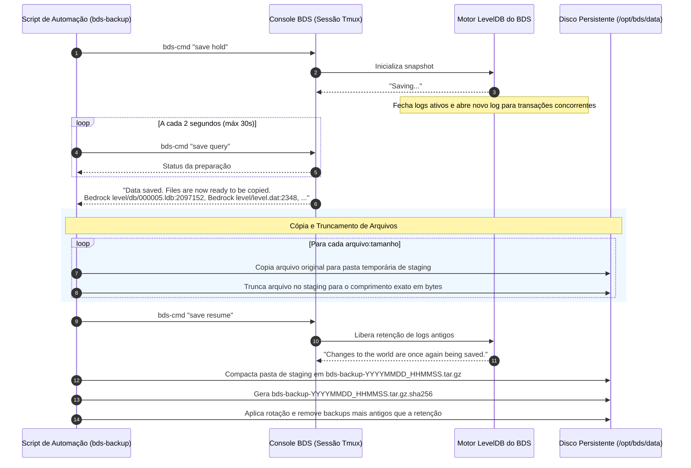

<!--
Responsabilidade: Especificação do procedimento de backup a quente e plano de restauração de desastres (Disaster Recovery).
Detalha a integração com o motor LevelDB do BDS via 'save hold' / 'save query' / 'save resume',
o truncamento obrigatório de bytes de arquivos de dados, compressão, rotação e validação de integridade.
-->

# Procedimento de Backup a Quente e Restauração de Desastres

## 1. Fundamentos Técnicos do Armazenamento do BDS

O Minecraft Bedrock Dedicated Server armazena o estado do mundo na pasta `worlds/<level-name>/` utilizando uma implementação em C++ do banco de dados **LevelDB**:
- **Tabelas SST / LDB (`.ldb`)**: Arquivos binários imutáveis contendo chunks e dados de blocos.
- **Log de Transações (`.log` / `00000x.log`)**: Arquivos de append-only contendo transações recentes que ainda não foram consolidadas nas tabelas `.ldb`.
- **Manifesto e Ponteiros (`CURRENT`, `MANIFEST-*`)**: Arquivos que descrevem o conjunto de arquivos válidos para o estado atual do banco.

### Por que a Cópia Simples (`cp -r`) Causa Corrupção?
Durante a execução ativa do servidor, o motor LevelDB realiza compactações em background e escritas assíncronas contínuas. Se uma ferramenta tradicional como `tar` ou `cp` ler os arquivos enquanto uma escrita estiver ocorrendo, o arquivo `.log` ou `.ldb` resultante conterá bytes parciais ou descompassados com o arquivo de manifesto. Quando o servidor tentar reiniciar com esse mundo copiado, o LevelDB falhará na abertura devido a checksum inválido ou inconsistência de bloco.

---

## 2. Protocolo Oficial de Backup a Quente da Mojang

A Mojang documenta no `bedrock_server_how_to.html` (v1.26.52.3) o protocolo oficial de snapshot a quente composto por 3 fases:



---

## 3. Requisito Crítico: Truncamento Exato de Bytes

O manual oficial especifica textualmente:
> *"The server will not pause while this is happening, so some files can be modified while the backup is taking place. As long as you only copy the files in the given file list and truncate the copied files to the specified lengths, then the backup should be valid."*

Quando `save query` retorna a lista de arquivos, cada arquivo é acompanhado pelo tamanho em bytes no momento exato em que o snapshot foi congelado. Enquanto o script copia o arquivo, novos blocos podem ser adicionados ao final do arquivo pelo jogo em andamento.
Portanto, o script de automação (`bds-backup.sh`) deve obrigatoriamente executar o truncamento através do comando:
```bash
# Exemplo conceitual para cada arquivo retornado:
# Entrada: Bedrock level/db/000005.ldb:2097152
cp "/opt/bds/data/worlds/$WORLD_PATH" "$STAGING_DIR/$WORLD_PATH"
truncate -s "$LENGTH_IN_BYTES" "$STAGING_DIR/$WORLD_PATH"
```
Isso garante que quaisquer bytes gravados após o comando `save hold` sejam removidos, resultando em um banco 100% transacionalmente consistente.

---

## 4. Política de Retenção e Rotação

Os backups gerados são armazenados no diretório persistente `/opt/bds/data/backups/`.
- **Formato do Arquivo**: `bds-backup-<level-name>-YYYYMMDD_HHMMSS.tar.gz`
- **Metadados de Verificação**: `bds-backup-<level-name>-YYYYMMDD_HHMMSS.tar.gz.sha256`
- **Conteúdo do Pacote**:
  1. Pasta completa do mundo fatiado (`worlds/<level-name>/`).
  2. Arquivos de configuração vigentes no momento do backup (`server.properties`, `allowlist.json`, `permissions.json`).
- **Política de Rotação Padrão**:
  - Manter os últimos **14 snapshots diários**.
  - O script remove automaticamente backups anteriores com base na data de modificação:
    ```bash
    find /opt/bds/data/backups/ -name "bds-backup-*.tar.gz" -type f -mtime +14 -delete
    find /opt/bds/data/backups/ -name "bds-backup-*.sha256" -type f -mtime +14 -delete
    ```

---

## 5. Procedimento de Restauração de Desastres (Runbook de Disaster Recovery)

Caso ocorra corrupção do mundo, falha de hardware ou deleção acidental, siga rigorosamente os passos abaixo:

### Passo 1: Interromper o Serviço BDS
Garante que nenhum processo tente acessar o diretório de dados durante a restauração:
```bash
systemctl stop minecraft-bedrock
systemctl is-active minecraft-bedrock # Deve retornar "inactive" ou "failed"
```

### Passo 2: Isolar o Estado Atual Danificado
Nunca apague o diretório atual diretamente antes de concluir a recuperação:
```bash
TIMESTAMP=$(date +%Y%m%d_%H%M%S)
mv /opt/bds/data/worlds /opt/bds/data/worlds.corrupted.$TIMESTAMP
mkdir -p /opt/bds/data/worlds
```

### Passo 3: Escolher e Validar o Arquivo de Backup
Localize o backup íntegro mais recente e valide o checksum SHA-256:
```bash
cd /opt/bds/data/backups/
ls -lh bds-backup-*.tar.gz

# Exemplo de validação:
sha256sum -c bds-backup-Bedrock_level-20260928_040000.tar.gz.sha256
# Saída esperada: "bds-backup-...tar.gz: SUCESSO" ou "OK"
```

### Passo 4: Extrair os Dados do Backup
Descompacte os arquivos preservando a árvore de diretórios:
```bash
tar -xzf bds-backup-Bedrock_level-20260928_040000.tar.gz -C /opt/bds/data/
```

### Passo 5: Corrigir Permissões de Arquivos
Garante que o usuário de sistema `bedrock` detenha a posse de todos os arquivos extraídos:
```bash
chown -R bedrock:bedrock /opt/bds/data/worlds
chmod -R u=rwX,go=rX /opt/bds/data/worlds
```

### Passo 6: Iniciar o Serviço e Verificar Logs
Inicie o servidor e acompanhe a inicialização do LevelDB via journald:
```bash
systemctl start minecraft-bedrock
journalctl -u minecraft-bedrock -n 50 -f
```
Verifique se a mensagem oficial de abertura do nível é impressa sem erros de LevelDB:
`[INFO] Level <level-name> opened successfully.`
