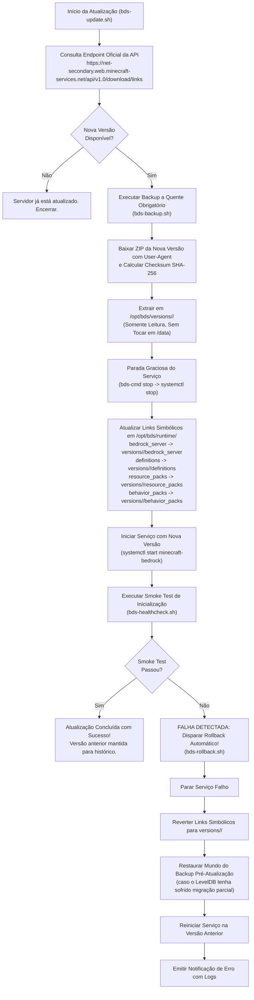

<!--
Responsabilidade: Especificação do processo de atualização determinística do BDS e política de rollback imediato.
Garante que novas versões da Mojang sejam aplicadas de forma segura, com backup prévio obrigatório,
validação de checksum SHA-256, reatribuição atômica de links simbólicos e rollback em caso de falha no smoke test.
-->

# Atualização Controlada e Política de Rollback Atômico

## 1. Princípios de Atualização

No ecossistema Minecraft Bedrock, clientes em consoles, celulares e PCs recebem atualizações compulsórias da Microsoft Store / Google Play. Quando o cliente atualiza de versão (ex.: `1.26.50` para `1.26.52`), ele perde a capacidade de conectar a servidores em versões anteriores (*"Outdated Server"*).

Portanto, o servidor deve suportar atualizações rápidas e frequentes, porém **estritamente controladas**:
- **Determinismo**: Cada versão é identificada pelo número exato da release da Mojang e pelo hash SHA-256 do pacote baixado.
- **Não Destrutivo**: Os binários da nova versão são extraídos em um diretório novo e isolado (`/opt/bds/versions/<nova_versao>/`), preservando intacta a versão anterior (`/opt/bds/versions/<versao_anterior>/`).
- **Backup Prévio Obrigatório**: Antes de qualquer intervenção, o pipeline de atualização executa automaticamente um backup a quente íntegro do mundo e das configurações.
- **Rollback em Segundos**: Se o novo binário apresentar falha de inicialização (crash, incompatibilidade de bibliotecas ou erro de carregamento do LevelDB), os links simbólicos de execução são revertidos imediatamente para a versão anterior.

---

## 2. Fluxo do Pipeline de Atualização



---

## 3. Gestão de Mudanças em `server.properties`

A cada lançamento, a Mojang pode introduzir novas propriedades no `server.properties` ou descontinuar parâmetros existentes.
Para evitar que configurações personalizadas do operador (como nome do servidor, porta, limites de memória ou gamemode) sejam perdidas:

1. O arquivo em produção `/opt/bds/data/config/server.properties` **nunca é sobrescrito** pelo pacote baixado.
2. O script de atualização compara o novo `server.properties` do pacote extraído com o arquivo atual do servidor, registrando em um arquivo de relatório (`/opt/bds/data/config/properties_diff_<versao>.log`) quaisquer novas propriedades introduzidas pela Mojang.
3. Se novas propriedades tiverem valores padrão essenciais para a estabilidade, o operador é notificado no log de atualização para incorporar ao seu template de configuração.

---

## 4. Runbook de Rollback Manual

Se após uma atualização bem-sucedida no smoke test os jogadores reportarem bugs graves na versão nova da Mojang, o operador pode executar a reversão manual instantânea:

```bash
# Executar utilitário de reversão dedicado
/opt/bds/bin/bds-rollback

# O script executará automaticamente:
# 1. systemctl stop minecraft-bedrock
# 2. Reatribuirá os links em /opt/bds/runtime/ para a pasta da versão n-1
# 3. Perguntará se deseja restaurar o mundo gravado no backup pré-atualização
# 4. systemctl start minecraft-bedrock
# 5. /opt/bds/bin/bds-healthcheck
```

### Critérios de Aceitação do Rollback:
- Tempo de execução total inferior a 60 segundos.
- Serviço restabelecido com status `active` na versão anterior.
- Integridade do banco LevelDB confirmada sem erros de inicialização.
